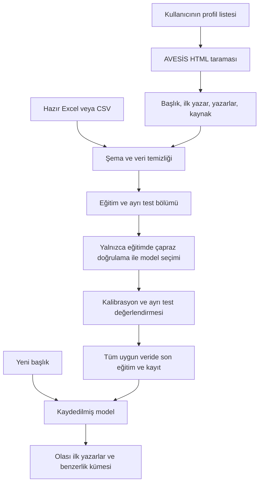

# AVESİS Akademisyen Tahmini

Kendi akademisyen bağlantılarınızdan yayın verisi toplayın veya hazır Excel/CSV dosyanızı kullanın. Makale başlıklarından **ilk yazarı** tahmin eden bir model eğitin ve yeni başlıklar için en olası adayları görün.

Proje Python ile çalışan bir komut satırı uygulamasıdır. Sabit bir üniversiteye veya kodun içine yazılmış bir hoca listesine bağlı değildir. Tarayıcı açmaz; AVESİS'in herkese açık HTML yayın sayfalarını okur. Eğitim ve kaydedilmiş modelle tahmin internet gerektirmez.

> Tahmin hedefi profil sahibi veya bütün ortak yazarlar değil, veri dosyasındaki **ilk yazardır**. Makale başlığından yazar belirlemek kesin bir kimlik doğrulama yöntemi değildir.

## İçindekiler

- [Neler yapar?](#neler-yapar)
- [Kurulum](#kurulum)
- [İnternetsiz ilk deneme](#internetsiz-ilk-deneme)
- [Kendi bağlantılarınızla veri toplama](#kendi-bağlantılarınızla-veri-toplama)
- [Hazır Excel veya CSV kullanma](#hazır-excel-veya-csv-kullanma)
- [Veri inceleme ve model eğitme](#veri-inceleme-ve-model-eğitme)
- [Tahmin yapma](#tahmin-yapma)
- [Sistem nasıl çalışır?](#sistem-nasıl-çalışır)
- [Ölçülen sonuçlar](#ölçülen-sonuçlar)
- [Proje yapısı](#proje-yapısı)
- [Testler ve geliştirme](#testler-ve-geliştirme)
- [GitHub'a yükleme](#githuba-yükleme)
- [Sorun giderme](#sorun-giderme)
- [Sınırlar ve geliştirme yönleri](#sınırlar-ve-geliştirme-yönleri)

## Neler yapar?

| Komut | İşlev |
| --- | --- |
| `discover` | Verdiğiniz dizin sayfalarının HTML bağlantılarından aday profiller çıkarır. |
| `scrape` | TXT/CSV/XLSX profil listesinden yayınları toplar, mevcut çıktıyla birleştirir. |
| `inspect` | Eğitim yapmadan veri temizliği ve yazar kapsamını raporlar. |
| `train` | Aday modelleri karşılaştırır, ayrı test kümesinde ölçer ve modeli kaydeder. |
| `predict` | Kaydedilmiş modelle tek başlık veya etkileşimli tahmin yapar. |

## Kurulum

**Gereksinimler:** Python 3.11 veya üzeri, ilk kurulumda paket indirmek için internet. Veri toplamak için ayrıca AVESİS erişimi gerekir. Komutları proje klasöründe çalıştırın. Windows kurulumunda Python'un terminalden erişilebilir olduğundan emin olun; bilgisayarınızda `python` yerine `py` kullanılıyorsa sanal ortam oluşturma komutunda `py` yazabilirsiniz.

### Windows PowerShell

```powershell
python -m venv .venv
.\.venv\Scripts\python.exe -m pip install --upgrade pip
.\.venv\Scripts\python.exe -m pip install -e ".[dev]"
.\.venv\Scripts\python.exe -m avesis_miner --help
```

Ortamı etkinleştirmek zorunlu değildir. Sonraki örneklerdeki `python` komutunu PowerShell'de doğrudan `.\.venv\Scripts\python.exe` olarak çalıştırabilirsiniz. Ortam etkinse yalnızca `python` yeterlidir:

```powershell
.\.venv\Scripts\Activate.ps1
```

### Linux / macOS

```bash
python3 -m venv .venv
source .venv/bin/activate
python -m pip install --upgrade pip
python -m pip install -e ".[dev]"
python -m avesis_miner --help
```

Geliştirme araçları gerekmiyorsa `python -m pip install -e .` kullanın. `requirements.txt` de aynı yerel paketi kurar. Ölçümde kullanılan tam paket sürümleri `requirements-lock.txt` dosyasında bulunur; aynı sürümleri kurmak için önce `python -m pip install -r requirements-lock.txt`, sonra `python -m pip install -e . --no-deps` çalıştırın. Bu liste mevcut Windows/Python 3.12 ortamının kaydıdır; başka platformlarda uygun wheel bulunması gerekir.

Kurulumdan sonra `python -m avesis_miner` yerine `avesis-miner` de kullanılabilir.

## İnternetsiz ilk deneme

Örnek CSV, iki **kurgusal yazar** ve 20 başlıktan oluşur. Gerçek performansı temsil etmez; kurulum ve iş akışını göstermek içindir.

```bash
python -m avesis_miner inspect --data examples/publications.csv
python -m avesis_miner train --data examples/publications.csv --output-dir artifacts/demo --clusters 2
python -m avesis_miner predict --model artifacts/demo/model.joblib --title "Neural networks for medical image classification"
```

`train` önce aday modellerin çapraz doğrulama skorlarını, ardından test doğruluğunu, macro-F1 ve ilk üç doğruluğunu yazdırır. Çıktılar:

- `model.joblib`: TF-IDF, kalibre sınıflandırıcı ve isteğe bağlı kümeleyici.
- `metrics.json`: veri temizliği, sınıf sayıları, aday modeller, seçilen parametreler ve test raporu.

## Kendi bağlantılarınızla veri toplama

### 1. Profil listesini hazırlayın

`examples/profiles.txt` dosyasını örnek alıp `profiles.txt` adında kendi listenizi oluşturun. Her satıra bir bağlantı yazın:

```text
https://avesis.ebyu.edu.tr/baran
https://avesis.ebyu.edu.tr/vkaya/yayinlar
```

`#` ile başlayan açıklamalar, boş satırlar ve tekrar eden aynı bağlantılar atlanır. Adresin sonuna `/yayinlar` eklemek zorunlu değildir. Birinci sütununda URL bulunan `.csv` veya `.xlsx` listeleri de kullanılabilir; başlıklı ve başlıksız eski listeler desteklenir. CSV ayıracı virgüldür.

Farklı üniversitelerin AVESİS profil adreslerini aynı listeye ekleyebilirsiniz. Adaptör `/<kullanıcı>/yayinlar` düzenini ve mevcut AVESİS HTML seçicilerini kullanır; farklı HTML sürümleri ayrıca uyarlama gerektirebilir. AVESİS dışındaki siteler için evrensel bir tarayıcı değildir.

### 2. Yayınları toplayın

```bash
python -m avesis_miner scrape --links profiles.txt --output data/publications.csv
```

Elinizdeki eski profil Excel'ini de doğrudan kullanabilirsiniz:

```bash
python -m avesis_miner scrape --links Linkler.xlsx --output data/publications.csv
```

Excel çıktı istiyorsanız çıktı uzantısını `.xlsx` yapın. Var olan çıktı okunur ve yeni satırlarla birleştirilir; tam olarak aynı başlık/yazar çifti tekrar eklenmez. Ek sütunlar korunur. Kaynak veri dosyalarınız kendiliğinden taşınmaz veya silinmez.

Toplanan sütunlar:

| Sütun | Anlamı |
| --- | --- |
| `title` | Yayın başlığı |
| `author` | Yayın öğesindeki ilk yazar |
| `authors` | Okunabilen bütün yazarların ` | ` ile birleştirilmiş hali |
| `source_url` | Kaydın alındığı yayın sayfası |

Taramayı sınırlandırabilirsiniz:

```bash
python -m avesis_miner scrape --links profiles.txt --output data/publications.csv --max-pages 5 --max-publications 50 --delay 1.5 --timeout 20
```

- `max-pages`: profil başına en fazla sayfa; varsayılan 10.
- `max-publications`: profil başına en fazla kayıt; varsayılan 0, yani bu sınır kapalı. Sayfa sınırı yine geçerlidir.
- `delay`: aynı sunucuda istekler arasında bekleme; varsayılan 1 saniye, en az 0,5 saniye. robots.txt daha uzun süre isterse o süre kullanılır.
- `timeout`: her HTTP isteği için zaman aşımı. Geçici sunucu hataları iki kez yeniden denenebilir.

Program robots.txt dosyasını kontrol eder. Erişimi yasaklanan sayfaları taramaz. Tek bir profilin başarısızlığı diğerlerini durdurmaz; uyarılar ve profil bazında ayrıntılar çıktı yanındaki `publications.scrape.json` dosyasına yazılır. Bütün profiller başarısızsa mevcut veri çıktısı değiştirilmez. Sayfa sınırına ulaşılması kısmi tarama olarak bildirilir. Taramayı durdurursanız o turdaki birikim kaydedilmez; önceden kaydedilmiş çıktı korunur.

### 3. İsteğe bağlı profil keşfi

Profil adreslerini elle yazmak yerine, **HTML içinde profil bağlantıları bulunan** dizin sayfalarını bir listeye ekleyebilirsiniz:

```bash
python -m avesis_miner discover --pages examples/directory_pages.txt --output data/profiles.txt
python -m avesis_miner scrape --links data/profiles.txt --output data/publications.csv
```

Keşif yalnızca verdiğiniz sayfaları okur; bütün üniversiteyi kendiliğinden dolaşmaz. Sonuç listesini taramadan önce gözden geçirin. JavaScript ile sonradan yüklenen sonuçlarda keşif çalışmayabilir; böyle bir durumda profil adreslerini dosyadan sağlayın. Eski Selenium-wire ve ağ trafiğinde kullanıcı adı arama bağımlılığı kaldırılmıştır.

## Hazır Excel veya CSV kullanma

Veriniz zaten varsa tarama aşamasını atlayın. Gerekli iki sütun:

```csv
title,author
"Derin öğrenme ile görüntü sınıflandırma","Örnek A."
"Tarımsal sulama verimliliğinin değerlendirilmesi","Örnek B."
```

Excel dosyasında ilk çalışma sayfası okunur. Desteklenen sütun adları:

| Standart ad | Kabul edilen eski adlar |
| --- | --- |
| `title` | `Makale Başlığı`, `Başlık` |
| `author` | `Yazar 1`, `Yazar` |
| `source_url` | `Kaynak` |

Diğer sütunlar korunur, sınıflandırmada kullanılmaz. Aynı alanın hem standart hem eski adını birlikte vermeyin. CSV dosyaları UTF-8, virgülle ayrılmış ve başlıklı olmalıdır. İsimleri tutarlı yazın; baş harf ve kısaltma farklarını yazılım güvenilir biçimde kişi kimliğine dönüştüremez.

## Veri inceleme ve model eğitme

Önce kapsamı görün:

```bash
python -m avesis_miner inspect --data data/publications.csv --min-samples 10
```

Rapor; boş/geçersiz satırları, tekrarları, aynı başlığın farklı ilk yazarlarla etiketlendiği çelişkileri, az örnek nedeniyle dışlanan satırları ve kalan yazar sayısını gösterir.

```bash
python -m avesis_miner train --data data/publications.csv --output-dir artifacts --min-samples 10 --test-size 0.2 --seed 42 --clusters 15
```

Mevcut yerel Excel verinizle:

```bash
python -m avesis_miner train --data Tum_Universite_Verisi.xlsx --output-dir artifacts
```

| Seçenek | Varsayılan | Açıklama |
| --- | --- | --- |
| `min-samples` | 10 | Temizlemeden sonra yazar başına gereken en az başlık sayısı. En az 5 olabilir. |
| `test-size` | 0.2 | Ayrı test için istenen oran; her sınıfı kapsamak için test sayısı artırılabilir. |
| `seed` | 42 | Veri bölme ve kümeleme için tekrar üretilebilir rastgelelik tohumu. |
| `clusters` | 15 | Benzerlik kümesi sayısı; 0 ile kümelemeyi kapatabilirsiniz. |

En az iki uygun yazar gerekir. Veri azsa veya test oranı eğitimde yeterli örnek bırakmıyorsa program açıklayıcı hatayla durur. Eşik düşürmek daha çok yazarı kapsar, ancak başarıyı düşürebilir. Başarıyı artırmak amacıyla yalnızca kolay sınıfları tutup sonucu bütün üniversite için geçerliymiş gibi sunmayın.

Yeni yayınlar toplandığında modeli yeniden eğitin. Mevcut model otomatik güncellenmez. Aynı çıktı klasörüne eğitim yapmak önceki model ve ölçüm dosyalarını yeniler; deneyleri saklamak için farklı klasörler kullanın.

## Tahmin yapma

Tek başlık:

```bash
python -m avesis_miner predict --model artifacts/model.joblib --title "Image segmentation using deep learning"
```

Etkileşimli kullanım:

```bash
python -m avesis_miner predict --model artifacts/model.joblib
```

Başlıkları sırayla yazın; `q` ile çıkın. En olası üç yazar ve kalibre edilmiş olasılıkları gösterilir. Aday sayısı ve belirsizlik eşiği değiştirilebilir:

```bash
python -m avesis_miner predict --model artifacts/model.joblib --top-k 5 --threshold 0.20
```

Boş başlık veya sözlükle hiç eşleşmeyen başlık için tahmin üretilmez. En yüksek olasılık eşikten düşükse belirsizlik uyarısı gösterilir; adaylar yine listelenir. Eşik başarı garantisi değildir. Karakter özellikleri nedeniyle ilgisiz bir metinde de kısmi eşleşme olabilir. Eğitimde bulunmayan bir yazarı sistem tanıyamaz.

Küme numarası, konu benzerliği grubudur; otomatik bir bilim dalı adı değildir. Olasılık da bilimsel yazarlık kanıtı değildir. Yalnızca kendinizin ürettiği veya güvendiğiniz model dosyalarını açın: joblib dosyaları yükleme sırasında kod çalıştırabilir. scikit-learn sürümü farklıysa yeniden eğitim gerekir.

## Sistem nasıl çalışır?



### Temizleme

Unicode normalizasyonu, Türkçe büyük/küçük harf dönüşümü, noktalama ve fazla boşluk temizliği yapılır. Sayılar korunur; sürüm ve teknik terimlerde anlam taşıyabilirler. Harici çeviri servisi kullanılmaz; başlıklar bir üçüncü taraf çeviri servisine gönderilmez ve eğitim her defasında çeviri beklemez. Türkçe ve İngilizce eş anlamlı kelimeler otomatik olarak aynı kavrama eşlenmez.

Normalize edilmiş aynı başlıklar tekilleştirilir. Bir başlık birden fazla ilk yazar etiketi taşıyorsa o başlığın bütün satırları eğitimden çıkarılıp raporlanır. Bu kayıtlar taramanın ham çıktısında korunur. Yazar başına minimum örnek eşiği temizlemeden sonra uygulanır. Normalizasyon yalnızca yazım farklarını azaltır; kişilerin kimliğini doğrulamaz.

### Özellikler ve model seçimi

Altı aday değerlendirilir: kelime TF-IDF ile SVM; karakter TF-IDF ile iki SVM ayarı; kelime ve karakter birleşimiyle iki SVM ayarı; birleşik özelliklerle lojistik regresyon. Kelime özellikleri 1–2 kelimelik, karakter özellikleri kelime sınırları içinde 3–5 karakterlik parçalardır. Kelime hazinesi üst sınırları sırasıyla 30.000 ve 50.000'dir. Sınıf ağırlıkları dengesiz yazar dağılımını dikkate alır.

Model seçimi yalnızca eğitim bölümünde, katmanlı çapraz doğrulamanın **macro-F1** ortalamasına göre yapılır. TF-IDF bir pipeline içindedir ve her eğitim katında yeniden öğrenilir. Ayrı test başlıkları özellik öğrenimine veya aday seçimine katılmaz. Seçilen sınıflandırıcının olasılıkları da eğitim içi çapraz doğrulamayla kalibre edilir; kalibrasyonun içinde bütün pipeline bulunur.

Değerlendirme sonrasında seçilen ayarlar bütün uygun veriyle yeniden eğitilir ve dağıtım modeli kaydedilir. Dolayısıyla `metrics.json` içindeki test sonuçları, test verisini hiç görmemiş değerlendirme modeline aittir. Son kaydedilmiş modelle aynı başlıkları tekrar deneyerek bağımsız test skoru hesaplamayın.

### Kümeleme

KMeans, son modelin TF-IDF uzayında eğitilir. Yazar sınıflandırıcısından bağımsızdır; küme numarası yazar tahminine girdi olarak verilmez. İstenen küme sayısı kullanılabilir başlık sayısını aşarsa otomatik düşürülür.

## Ölçülen sonuçlar

19 Ekim 2026'da, projedeki mevcut yerel veri dosyası üzerinde yapılan ölçüm:

| Ölçüt | Kelime SVM karşılaştırması | Seçilen birleşik SVM |
| --- | ---: | ---: |
| Test doğruluğu | %66,67 | **%72,73** |
| Macro-F1 | 0,5656 | **0,6785** |
| İlk üç doğruluğu | %84,85 | %84,85 |

634 ham satırdan, çelişki ve tekrar temizliği ile yazar başına en az 10 örnek koşulundan sonra **330 başlık ve 15 yazar** kaldı. Eğitimde 264, testte 66 başlık kullanıldı. En sık yazarı seçen basit yaklaşımın doğruluğu %15,15 oldu. Seçilen modelin artışı **6,06 yüzde puanı**, yani bu testte dört ek doğru tahmindir.

Bu karşılaştırma yeni ve sızıntısı düzeltilmiş akıştaki kelime SVM referansına aittir; eski betiğin birebir yeniden çalıştırılmış skoru değildir. Sonuçlar tek bir rastgele bölmeye dayanır, istatistiksel üstünlük veya başka üniversitelerde aynı performans iddiası taşımaz. Az yayınlı yazarlar bu sonuçlara dahil değildir. Ham veri açık depoya eklenmediği için bu ölçümü tekrar üretmek aynı veri dosyasını gerektirir; paylaşılan örnek CSV bu veri değildir.

Özet ve kaynak dosya parmak izi: [docs/benchmark.json](docs/benchmark.json). Yerel modelle birlikte daha ayrıntılı sınıf raporu `artifacts/metrics.json` içinde bulunur. Kaynak ham dosya adı ve sütunları eski proje ile uyumlu kalmıştır.

Doğruluk doğru ilk adayı, macro-F1 yazarlara eşit ağırlık veren performansı, ilk üç doğruluğu ise doğru yazarın ilk üç aday arasında bulunma oranını ölçer. Az sınıflı örnek veride ilk üç ölçütü çok kolaydır; iki sınıfta her zaman %100 olabilir.

## Proje yapısı

```text
avesis_miner/
  cli.py          Komutlar ve kullanıcı mesajları
  data.py         Dosya okuma, şema, temizleme, kayıt
  scraping.py     AVESİS HTML adaptörü ve HTTP istemcisi
  model.py        Model seçimi, değerlendirme, kayıt, tahmin
examples/         Kullanıcı girdileri ve kurgusal deneme verisi
tests/            Veri, tarama, model ve entegrasyon testleri
docs/             Ölçüm özeti ve teknik notlar
.github/          CI iş akışı, issue ve pull request şablonları
WebScraping.py    Yeni CLI'ye yönlendiren eski giriş noktası
LinkBulucu.py     discover komutuna yönlendiren eski giriş noktası
```

Eski `python WebScraping.py` kullanımı artık bütün işlemleri kendiliğinden başlatmaz; alt komut ister. Örneğin `python WebScraping.py train --data Tum_Universite_Verisi.xlsx` kullanılabilir. `python LinkBulucu.py --pages examples/directory_pages.txt` ise keşif yapar.

Özgün Excel, Word ve PDF dosyaları yerelde korunur. Eski rapor ve sunum bu sürümün belgeleri değildir; güncel akış için bu README'yi esas alın. `.gitignore` ham kaynakları, sanal ortamı ve üretilen model/veri klasörlerini GitHub'a kazara eklemeyi önler. Bu, bütün dizinlerdeki bütün veri dosyalarını tarayan bir güvenlik filtresi değildir; commit öncesi dosyaları gözden geçirin.

## Testler ve geliştirme

```bash
python -m pip install -e ".[dev]"
ruff check .
python -m pytest -q
```

Testler internet kullanmaz. HTML ayrıştırma, robots engeli, mevcut üç sütunlu verinin korunması, başarısız taramada dosyaya dokunulmaması, eski Excel şeması, yinelenen/çelişkili başlıklar, test kelimesinin eğitim sözlüğüne sızmaması, tam eğitim-kayıt-yükleme ve boş/bilinmeyen girdiler kontrol edilir.

GitHub Actions; push ve pull request olaylarında Python 3.11, 3.12 ve 3.13 üzerinde lint ve test çalıştıracak şekilde hazırlanmıştır. Yerel doğrulama Windows/Python 3.12 üzerinde yapılmıştır; GitHub çalışmaları henüz bu klasörden başlatılmamıştır. Küçük canlı denemede EBYÜ'deki iki profilden toplam altı kayıt okunmuştur; bütün AVESİS kurulumları test edilmemiştir.

Katkı süreci: [CONTRIBUTING.md](CONTRIBUTING.md). Değişiklikler: [CHANGELOG.md](CHANGELOG.md).

## GitHub'a yükleme

### İlk yayın

1. GitHub hesabınızda yeni bir depo oluşturun. Örneğin `avesis-author-miner` adı kullanılabilir. Yerel dosyalarla çakışmaması için GitHub tarafında başlangıç README'si oluşturmayın.
2. Aşağıdaki komutları proje klasöründe çalıştırın. Yerelde depo zaten başlatılmışsa `git init` adımı atlanabilir.

```bash
git init -b main
git status --short
git add README.md pyproject.toml requirements.txt requirements-lock.txt .gitignore avesis_miner examples tests docs .github CONTRIBUTING.md CHANGELOG.md WebScraping.py LinkBulucu.py
git diff --cached --stat
git commit -m "Prepare configurable AVESIS author prediction project"
```

3. GitHub'ın gösterdiği **kendi depo adresinizi** kullanarak uzak depoyu bağlayın ve gönderin. Aşağıdaki adres bir yer tutucudur; doğrudan çalıştırmadan değiştirin.

```bash
git remote add origin https://github.com/KULLANICI_ADINIZ/DEPO_ADINIZ.git
git push -u origin main
```

Git sizden kimlik bilgisi isterse GitHub'ın desteklediği oturum açma yöntemini kullanın. Parolaları veya erişim anahtarlarını proje dosyalarına yazmayın. README, GitHub depo ana sayfasında otomatik görünür. Actions sekmesinden testleri izleyebilirsiniz.

### Sonraki geliştirmeler

```bash
git switch -c improve-parser
# Değişiklikleri yapın, lint ve testleri çalıştırın.
git add avesis_miner tests README.md
git commit -m "Improve publication parsing"
git push -u origin improve-parser
```

GitHub'da pull request açın, değişiklikleri inceleyin ve CI yeşil olduğunda birleştirin. Ardından yerelde `main` dalına dönüp `git pull` yapın. Tek başınıza çalışırken de bu akış değişikliklerin izlenmesini kolaylaştırır.

Ham akademik veri ve eski raporlar varsayılan olarak paylaşılmaz. Paylaşmak isterseniz kaynakların paylaşım koşullarını değerlendirip açık bir veri politikası belirleyin. **Lisans henüz seçilmedi:** açık kaynak kullanım izinleri için depo sahibi olarak MIT, Apache-2.0 veya uygun başka bir lisansı ayrıca seçmelisiniz. Kod lisansı veri kaynaklarının kullanım haklarını kendiliğinden kapsamaz.

## Sorun giderme

| Sorun | Kontrol / çözüm |
| --- | --- |
| `python` bulunamıyor | Python kurulumunu ve PATH'i kontrol edin; Windows'ta `py` deneyin. |
| `ModuleNotFoundError` | Aynı sanal ortamda `python -m pip install -e .` çalıştırın. |
| Dosya bulunamıyor | Proje klasöründe olduğunuzu kontrol edin; boşluk içeren yolları tırnak içine alın. |
| Sütun hatası | İlk sayfada `title`/`author` veya desteklenen Türkçe başlıkları kullanın. |
| Yeterli yazar/örnek yok | Daha çok veri ekleyin; `inspect` çıktısını inceleyin. `min-samples` en az 5 olabilir. |
| Hiç yayın okunamadı | Profil URL'sini, interneti, robots uyarısını ve sitenin HTML yapısını kontrol edin. |
| Keşif bağlantı bulamıyor | Sonuçlar JavaScript ile geliyor olabilir; profil listesini elle hazırlayın. |
| Excel'e yazılamıyor | Dosyayı Excel'de kapatın veya başka çıktı adı kullanın. |
| Model sürümü uyuşmuyor | Mevcut scikit-learn sürümüyle tekrar eğitim yapın. |
| Düşük doğruluk | İlk yazar etiketlerini, aynı adlı kişileri, yazar başına örnek sayısını ve alanların benzerliğini inceleyin. |

Ayrıntılı log için genel seçeneği alt komuttan **önce** kullanın: `python -m avesis_miner --verbose scrape --links profiles.txt`.

## Sınırlar ve geliştirme yönleri

- Sistem başlıktan ilk yazar tahmini yapar. Gerçek yazarlığı veya intihali saptamaz.
- İsim kısaltmaları aynı kişiyi bölebilir veya farklı kişileri tek sınıfta birleştirebilir. İleride ORCID ve güvenilir yazar kimlikleri kullanılabilir.
- Yalnızca normalize edilmiş tam tekrarlar ayıklanır. Çok benzer başlıklar eğitim ve testte kalabilir. Daha güçlü değerlendirme için yayın kimliği, yakın tekrar grupları ve zaman bazlı ayırma gerekir.
- Test sonucu mevcut etiket kümesi içindir. Model, hiç görmediği bir yazarı aday olarak veremez.
- Farklı diller arasında anlamsal eşleme yoktur. Çok dilli temsil modelleri ayrı bir eğitim deneyiyle değerlendirilebilir.
- HTML sayfalama için yaygın `page`, `p`, `sayfa`, `pageNo`, `pageNumber` sorgu parametreleri izlenir. JavaScript/API tabanlı sayfalama, giriş gerektiren sayfalar veya farklı şablonlar için yeni adaptör gerekir.
- Profil keşfi ve yayın ayrıştırma sitenin değişmesiyle bozulabilir. Boş/kısmi sonuç raporu takip edilmelidir.

Teknik yöntem için kaynaklar: [scikit-learn veri sızıntısı ve pipeline rehberi](https://scikit-learn.org/stable/common_pitfalls.html), [olasılık kalibrasyonu](https://scikit-learn.org/stable/modules/calibration.html).
# avesis-author-miner

